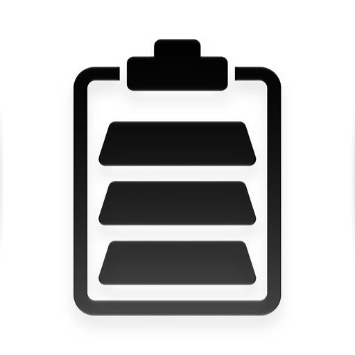

<div align="center">



# ClipShelf

**An open-source, native macOS clipboard shelf built in Swift, AppKit, and SwiftUI.**

[](https://www.apple.com/macos/)
[](https://swift.org/)
[](LICENSE)

</div>

---

## Features

- **Non-activating bottom shelf (`⇧⌘V`)**: Slides up along the bottom of the active display across Spaces and full-screen apps without stealing focus context.
- **Visual cards**: Source-app color-tinted headers, app icons, relative timestamps, rich OpenGraph link previews (`LinkPresentation`), image thumbnails, file badges, and color swatches.
- **Expanding inline search (`⌘F`)**: Smoothly expands the search field while keeping the history icon visible and filtering cards live.
- **Color-coded Pinboards (`+`)**: Organize frequently used snippets, links, images, and files into custom colored boards that survive history clearing.
- **Native macOS Settings (`⌘,`)**:
  - **General**: Open at Login, Show in Menu Bar, Sound Effects, History Retention, Clear Unpinned History.
  - **Shortcuts**: Interactive global shortcut recorder.
  - **Rules**: Ignore confidential & transient pasteboard content, toggle link previews, and manage Ignored Applications (pre-populated with **Passwords** and **Keychain Access**).
- **Local-first storage**: Fast SQLite database + on-disk image blob cache in `~/Library/Application Support/ClipShelf/` — zero telemetry, zero accounts.
- **Icon Composer native icon**: Includes `AppIcon.icon` compiled via `xcrun actool` into macOS Liquid Glass `Assets.car` and `AppIcon.icns`.

---

## Keyboard Shortcuts

| Shortcut | Action |
| :--- | :--- |
| `⇧⌘V` | Toggle the bottom clipboard shelf (customizable) |
| `⌘F` | Expand & focus inline search |
| `←` / `→` | Select previous / next card |
| `↩` or Double-click | Paste selected card into the previously active app |
| `⇧↩` | Paste selected card as plain text |
| `⌘1` – `⌘9` | Instantly paste slot 1–9 |
| `Space` | Quick Look preview |
| `⌘⌫` | Delete selected card |
| `⌘,` | Open Settings |
| `Esc` | Close search or dismiss shelf |

---

## Build & Install

Requires macOS 14+ and Xcode Command Line Tools (Xcode with `actool` for compiling `AppIcon.icon`).

```bash
git clone https://github.com/r0bledas/ClipShelf.git
cd ClipShelf
./scripts/build_app.sh release
cp -R build/ClipShelf.app /Applications/
open /Applications/ClipShelf.app
```

> **Accessibility permission**: On your first paste, macOS will prompt for Accessibility permission so ClipShelf can send `⌘V` into the previously focused app. Without it, selecting a card still copies it to your system clipboard.

### Run Unit Tests

```bash
swift test
```

---

## Optional Extras

### Import Existing Paste.app History
If you previously used Paste.app locally, you can import your clipboard history, images, link previews, and pinboards (read-only) into ClipShelf:

```bash
python3 scripts/import_paste_history.py
```

### Custom Sound Overrides (Gitignored)
ClipShelf ships with original synthesized `Copy.aiff` and `Paste.aiff` sounds (`scripts/generate_sounds.py`). To use your own local sound effects without tracking them in git, drop `Copy.aiff` and/or `Paste.aiff` into either:
- `~/Library/Application Support/ClipShelf/Sounds/` (takes effect on next launch), or
- `LocalSounds/` in the repo root (gitignored, bundled when running `./scripts/build_app.sh`).

### Customize the App Icon
Open `AppIcon.icon` in Xcode's **Icon Composer**, edit layers or materials, and re-run `./scripts/build_app.sh release`.

---

## License

[MIT](LICENSE)
